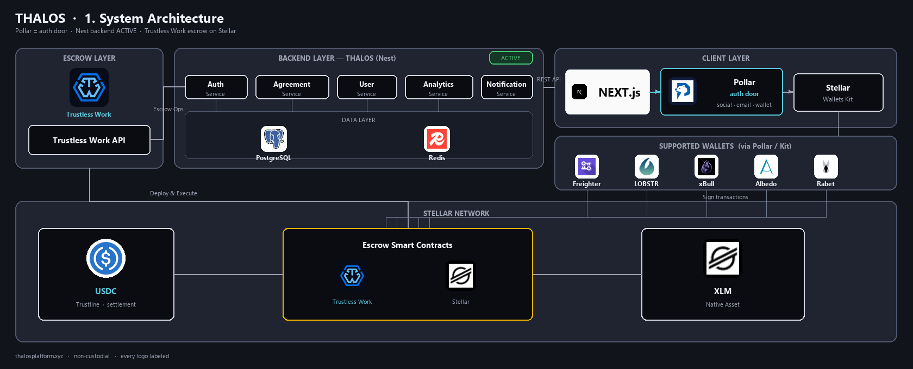
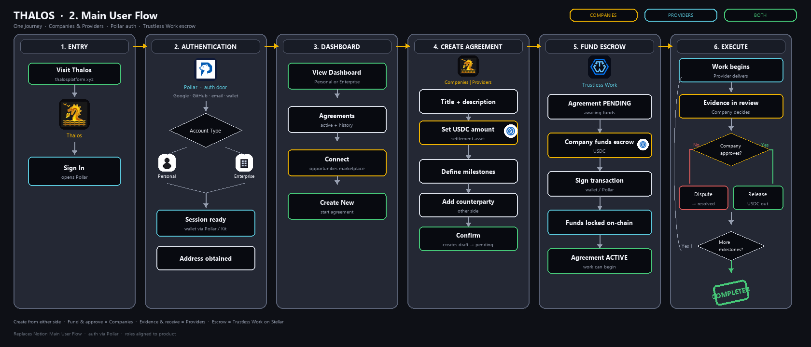
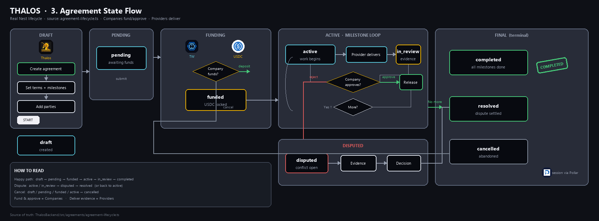
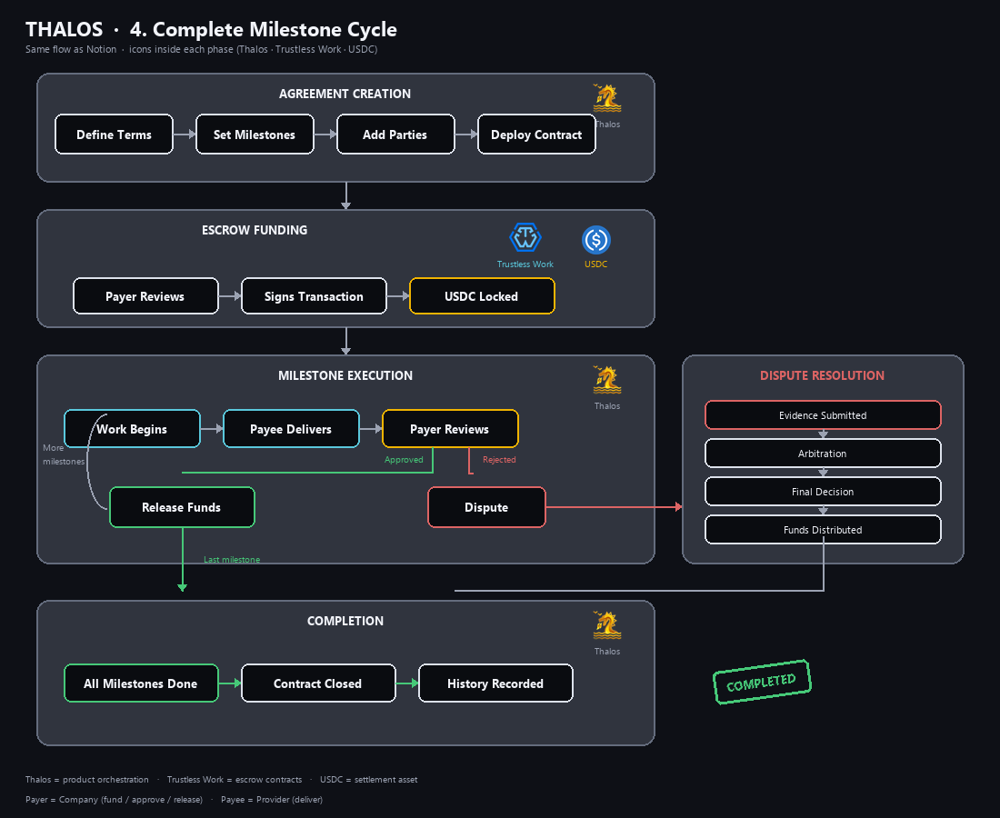
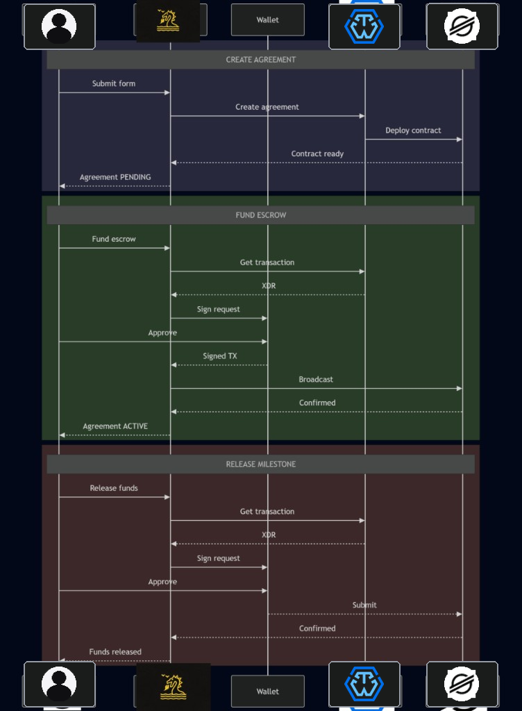
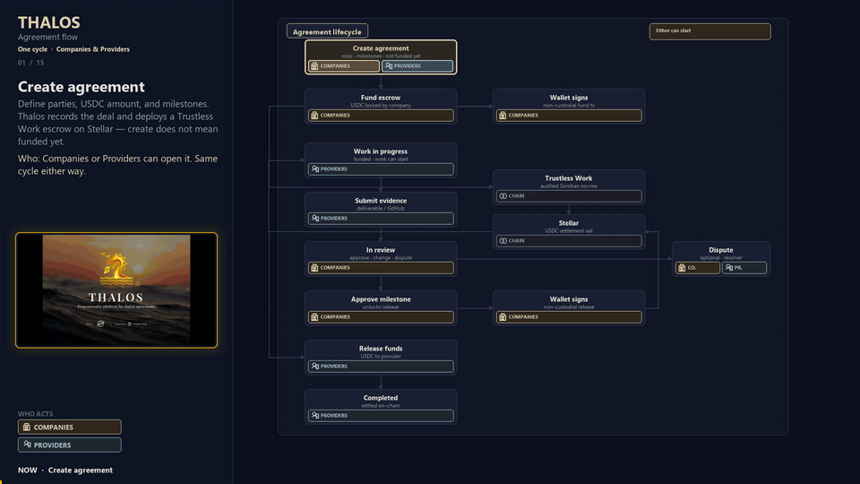

  

  <b>Digital agreements.</b> 
  Escrow orchestration on Stellar · powered by Trustless Work

# Thalos

Thalos is an escrow orchestration layer built on the **Stellar** network. It connects transparently with the **[Trustless Work](https://docs.trustlesswork.com)** protocol to offer programmable agreements and milestone-based payments — simple and secure, designed for end users who need to protect their transactions without dealing with blockchain complexity.

> Funds stay secured until approval. Agreements that hold.

---

## Overview

Digital work still often relies on informal deals, screenshots, or blind upfront transfers. That creates friction, disputes, and risk for both sides.

Thalos replaces that with transparent, verifiable escrow rules:

**create → fund → work → evidence → review → approve → release**  
(optional **dispute** when needed)

Companies (payers) and Providers (payees) share one cycle. Either side can open an agreement; funding and release stay non-custodial via wallet signatures. Settlement is **USDC** on Stellar / Soroban.

---

## Platform Links

| Resource | URL |
| --- | --- |
| Website | https://www.thalosplatform.xyz |
| Platform | https://thalos.app |
| Frontend | https://github.com/Thalos-Infrastructure/ThalosFrontend |
| Backend | https://github.com/Thalos-Infrastructure/ThalosBackend |
| Documentation | https://github.com/Thalos-Infrastructure/thalos-docs |
| Instagram | https://instagram.com/thalos_platform |
| Trustless Work Docs | https://docs.trustlesswork.com |
| Stellar Network | https://stellar.org |
| Contact | thalosinfrastructure@gmail.com |

---

## Tech Stack

| Layer | Technology |
| --- | --- |
| Frontend | Next.js 16, React 19, TypeScript 5 |
| Styling | Tailwind CSS 4, shadcn/ui, Radix UI |
| Wallet Integration | Stellar Wallets Kit, Freighter API |
| Escrow Protocol | Trustless Work API |
| Smart Contracts | Soroban (Stellar) |
| Primary Asset | USDC (Circle) |
| Backend | Node.js, PostgreSQL, Redis *(expanding)* |
| Deployment | Vercel |

---

## 1. System Architecture

Four-layer platform: Client → Backend → Escrow (Trustless Work) → Stellar.

| Layer | Components | Status |
| --- | --- | --- |
| **Client** | Next.js frontend, Stellar Wallets Kit | Active |
| **Wallets** | Freighter, xBull, LOBSTR, Albedo, Rabet | Active |
| **Backend** | Auth, Agreement, User, Notification, Analytics · PostgreSQL · Redis | Expanding |
| **Escrow** | Trustless Work API | Active |
| **Blockchain** | Stellar Network, Soroban smart contracts, USDC trustline | Active |

  

---

## 2. Main User Flow

End-to-end journey from first visit to completed agreement. Supports **Personal** and **Enterprise**, with role-specific paths for companies and providers.

| # | Phase | Description |
| --- | --- | --- |
| 1 | Entry | Visit platform / landing |
| 2 | Authentication | Personal or Enterprise · connect wallet |
| 3 | Dashboard | Active agreements, balances, metrics |
| 4 | Create Agreement | Title, amount, milestones, counterparty |
| 5 | Fund Escrow | Payer signs · USDC locked |
| 6 | Execute Milestones | Work → evidence → review → release |
| 7 | Dispute Resolution | Optional |
| 8 | Completion | Settled on-chain · history recorded |

  

---

## 3. Agreement State Flow

Agreement lifecycle states: draft → pending → funded → active → in_review → completed  
(with dispute / cancel paths).

  

---

## 4. Complete Milestone Cycle

One milestone loop inside an active agreement: deliver → review → approve/release (or dispute), then next milestone or completion.

  

---

## 5. Transaction Sequence

Create · fund · release — how Thalos, wallet, Trustless Work, and Stellar interact.

  

---

## Agreement Lifecycle (Companies & Providers)

Animated overview of the shared cycle: either party can start; fund & approve = Companies; evidence & receive = Providers.

  

| Step | Who acts | Notes |
| --- | --- | --- |
| Create agreement | Companies or Providers | Not funded yet |
| Fund escrow | Companies | USDC locked |
| Wallet signs (fund) | Companies | Non-custodial |
| Work in progress | Providers | Funded · work can start |
| Submit evidence | Providers | Deliverable / GitHub |
| In review | Companies | Approve · change · dispute |
| Dispute *(optional)* | Both | Trustless Work rules |
| Approve milestone | Companies | Unlocks release |
| Wallet signs (release) | Companies | Non-custodial |
| Release funds | Providers | USDC to provider |
| Completed | Providers | Settled on-chain |

---

## Principles

- **Security first** — funds protected by enforceable on-chain logic.
- **Simplicity** — escrow should feel like normal product UX.
- **Neutrality** — protect company and provider equally.
- **Clarity** — status, progress, and next action always visible.

---

## Team

<table>
  <tr>
    <td align="center">
      <a href="https://github.com/Kalchaqui">
         
        <b>Diego Raúl Barrionuevo</b>
      </a>
    </td>
    <td align="center">
      <a href="https://github.com/leandromasotti">
         
        <b>Leandro Masotti</b>
      </a>
    </td>
    <td align="center">
      <a href="https://github.com/ManuelJG1999">
         
        <b>Manuel Jiménez Garro</b>
      </a>
    </td>
  </tr>
</table>

---

## Roadmap

**Near term**
- Clearer agreements UX (filters, perspective, next action)
- Evidence & demo readiness for ecosystem programs
- Backend hardening (auth, notifications, analytics)

**Next**
- Deeper agreement templates / customization
- Additional payment rails
- Broader digital-agreement use cases

---

Thalos — **Digital agreements.**
